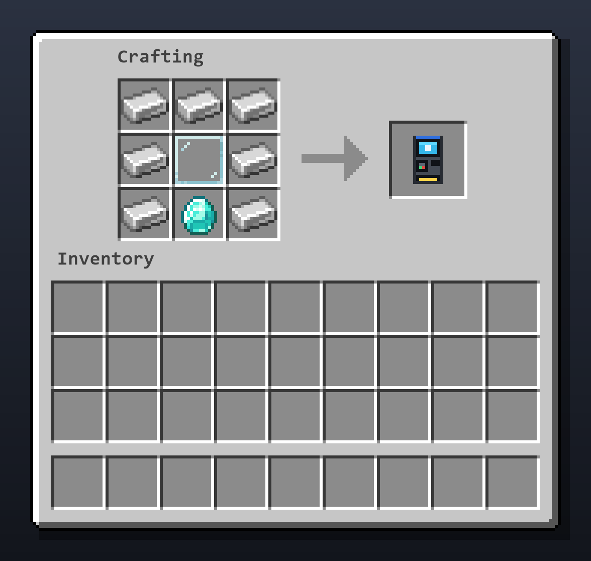

# 💶 New Currencies

Euro coins and banknotes for Minecraft, with an **ATM** that connects them to your server's economy. Available for **Fabric** and **NeoForge**.

This repository holds the public side of the mod: issues, documentation and assets. The source code is private.

| | |
|---|---|
| 📥 Download | [Modrinth](https://modrinth.com/mod/new-currencies) · [CurseForge](https://www.curseforge.com/minecraft/mc-mods/new-currencies) |
| 🐛 Problems or ideas | [Open an issue](https://github.com/RadonMC/NewCurrencies-public/issues/new/choose) |
| 📝 What changed | [Changelog](CHANGELOG.md) |
| 📄 License | [All Rights Reserved with modpack exceptions](LICENSE) |

## ✨ What it adds

* 🪙 **Coins and banknotes:** 1€ and 2€ coins, 5€, 10€, 20€, 50€, 100€, 200€ and 500€ banknotes.
* 🏧 **ATM:** a two-block-tall machine to withdraw coins and banknotes from your account and deposit them back.
* 🔁 **Exchange recipes:** combine and split denominations in a crafting grid, with the same total value.
* 🌍 English and Italian.

## 🏧 The ATM



Place it and right-click it. The menu shows your balance, lets you withdraw any coin or banknote (shift-click for 10) and deposit them again: click a coin or banknote in your inventory to deposit that stack (right-click for one), or use **Deposit all**.

The ATM needs an economy mod:

| Loader | Economy mods |
|---|---|
| Fabric | Any mod implementing the [Common Economy API](https://github.com/Patbox/common-economy-api) (for example Savs Common Economy), bundled so there is nothing else to install. Also EconomyCraft (needs Architectury API). |
| NeoForge | EconomyCraft (needs Architectury API). |

One euro is one unit of the economy's currency. Settings are in `config/newcurrencies.json`:

```json
{
  "provider": "",
  "currency": ""
}
```

* `provider`: which economy to use (`common_economy_api` or `economycraft`). Empty uses the first one available.
* `currency`: which currency to use when the economy has several (for example `mod_id:dollar`). Empty uses the first one.

## 📋 Requirements

* **Minecraft:** 26.1, 26.1.1, 26.1.2, 26.2, 26.3
* **Java:** 25 or newer
* **Fabric:** Fabric Loader 0.19 or newer and Fabric API
* **NeoForge:** NeoForge for your Minecraft version (26.3 is still in beta)
* **Environment:** client and server. Install it on both for multiplayer.

## 🐛 Reporting a problem

Use the [issue forms](https://github.com/RadonMC/NewCurrencies-public/issues/new/choose). The more of this you include, the faster it can be fixed:

* mod version, loader (Fabric or NeoForge) and Minecraft version,
* which economy mod you use,
* `latest.log` (and `crash-reports/` if the game crashed).

For the text used on the Modrinth and CurseForge pages see [`docs/`](docs/).
